# 基于ECDH与AES-GCM的端到端加密聊天室

利用椭圆曲线Diffie-Hellman协商会话密钥，采用AES-GCM加密消息并校验完整性，结合数字签名认证身份，实现防窃听、防篡改的安全即时通讯。

X25519 就是椭圆曲线 Diffie-Hellman；每条消息用 AES-256-GCM 加密并校验完整性；Ed25519 数字签名认证身份和预密钥。X3DH 和双棘轮是把这三句话做出来的方法，写在下面的原理里，不是项目的另一个名字。

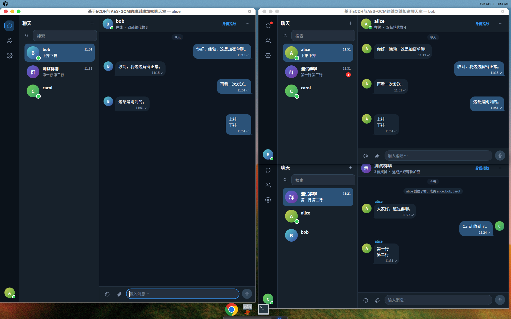

下面这段是同一次演示：左侧 alice 切换主题并发消息，右上 bob 回复，右下 carol 停在群「测试群聊」。动图会直接播放；点开动图可以看 mp4 原片。

[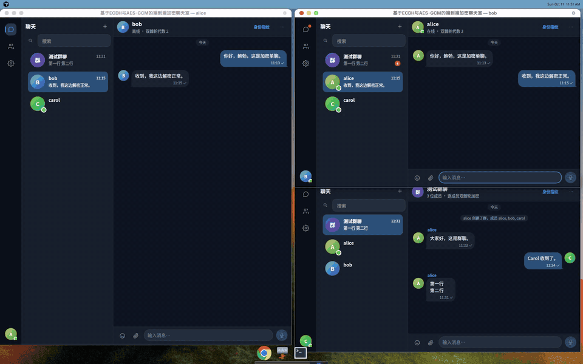](docs/media/ui-demo.mp4)

## 目录

- [先用大白话讲清楚](#先用大白话讲清楚)
- [界面长什么样](#界面长什么样)
- [桌面上怎么找人、拉群、发文件](#桌面上怎么找人拉群发文件)
- [五分钟跑起来](#五分钟跑起来)
- [系统是怎么分层的](#系统是怎么分层的)
- [图片、视频和文件](#图片视频和文件)
- [每个人手上有哪些钥匙](#每个人手上有哪些钥匙)
- [注册和登录在证明什么](#注册和登录在证明什么)
- [第一条消息如何算出同一把 SK](#第一条消息如何算出同一把-sk)
- [这条握手的后量子扩展已经做了](#这条握手的后量子扩展已经做了)
- [为什么后面每条消息还要换钥匙](#为什么后面每条消息还要换钥匙)
- [每条换链为什么还混入后量子封装](#每条换链为什么还混入后量子封装)
- [乱序、重放和篡改](#乱序重放和篡改)
- [不核对指纹时服务器能做什么](#不核对指纹时服务器能做什么)
- [三个人的群聊是怎么加密的](#三个人的群聊是怎么加密的)
- [群成员名单是怎么防伪造的](#群成员名单是怎么防伪造的)
- [关掉再打开，为什么还能接着聊](#关掉再打开为什么还能接着聊)
- [两套界面，同一套引擎](#两套界面同一套引擎)
- [建议的读码顺序](#建议的读码顺序)
- [测试时应该看到什么](#测试时应该看到什么)
- [和 Signal、WhatsApp 的差别](#和-signalwhatsapp-的差别)
- [论文对应哪段代码](#论文对应哪段代码)

## 先用大白话讲清楚

把它想成微信，但中间那台服务器只是邮局。

Alice 在自己电脑上把「你好鲍勃」放进信封，用只有她和 Bob 能推导出来的钥匙封上。服务器负责把信封交给 Bob；Bob 不在线，就把信封按顺序存进抽屉，等他上线再交。服务器看得到收件人、发件人，也看得到一串 base64，但看不懂信纸上的字。日志里搜「你好鲍勃」应当没有结果。

题目里的三句话，分别落在三段代码上：

| 答辩时要说的话 | 直白意思 | 代码在哪 |
| --- | --- | --- |
| 椭圆曲线 Diffie-Hellman 协商会话密钥 | 双方各拿自己的私钥和对方的公钥做 X25519，谁也不把私钥发出去，却能算出同一段共享秘密 | `src/x3dh.py` 的四次 DH，以及 `src/double_ratchet.py` 里每次换链时的那一次 DH |
| AES-GCM 加密消息并校验完整性 | 每一条聊天记录单独用一把 32 字节消息钥匙做 AES-256-GCM。密文被改一个字节，认证标签对不上 | `src/double_ratchet.py` 的 `encrypt` / `decrypt` |
| 数字签名认证身份 | Ed25519 身份钥匙只负责签名：签预密钥、签会话的第一条消息、签登录挑战 | `src/prekeys.py`、`src/x3dh.py`、`src/client.py` 的登录 |

有一件事必须先说死：X3DH 算出的 32 字节 `SK` 只用来启动双棘轮，绝不直接拿去加密聊天内容。如果有人用一把固定的 ECDH 钥匙加密全部消息，那就没有做这个题目。

曲线运算、AES、HMAC、HKDF 全部调用 Python `cryptography`。仓库里没有自己写的曲线公式，也没有 XEdDSA。签名钥匙和协商钥匙从生成时就分开。

## 界面长什么样

桌面端是 PySide6 三栏。最左是窄图标栏：聊天、联系人、设置。中间是会话列表，默认大约 300 像素，可以拖边界。右边是聊天区。窗口窄于 800 像素时收成单栏，左上角返回会话列表。

会话一行里有头像、名字、最后一条消息、时间和未读数字。头像按用户名生成固定渐变，在线时右下角有一颗带白边的绿点。自己的气泡靠右，对方的靠左，连续消息并成一组，只在这一组的第一条显示头像和名字。日期用「今天 / 昨天」隔开。像「alice 创建了群」这种系统消息是中间的灰色小胶囊。验签失败、重放拒绝、GCM 失败用红色边框的警告卡，旁边有一句短说明。

顶栏是对方头像、名字，以及在线状态或「正在输入…」。单聊还能看到双棘轮代数和指纹摘要，完整 16 组在「身份指纹」卡片里。这里的「已发送」只表示服务器收下了信封，不表示对方已经阅读。单勾是服务器已收下，发送中是时钟，失败是红色感叹号，点一下可以重发。

底部输入栏一直在。左边是表情和附件，中间是圆角多行输入框，占位文字是「输入消息…」，右边是发送。没有字的时候按钮是灰色麦克风；写进字就变成主题色纸飞机。Enter 发送，Shift+Enter 换行。输入法还在组字时，Enter 不会把半截拼音发出去。框最多长到 6 行，再往下就在框里面滚动。选中图片、视频或文件后，输入栏上方先滑出一张圆角预览卡。联系人按首字母分节，拉群不用把用户名敲完整。这两件事的点法和边界写在下一节。

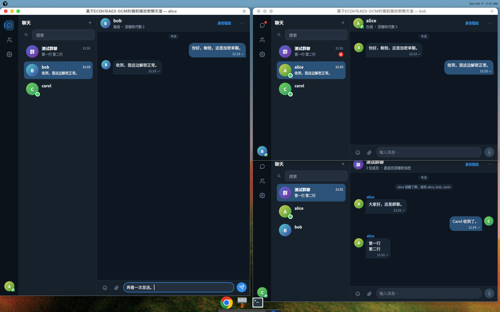

主题有三套，在设置里切换，颜色大约 200 毫秒过渡：

- **Telegram 深色**：背景 `#0E1621`，自己的气泡 `#2B5278`。
- **微信绿**：背景 `#EDEDED`，自己的气泡 `#95EC69`。
- **浅色 Telegram**：浅色背景，自己的气泡是蓝色。

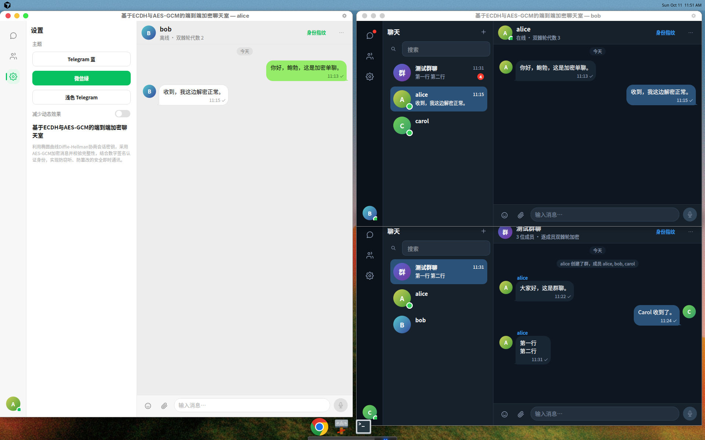

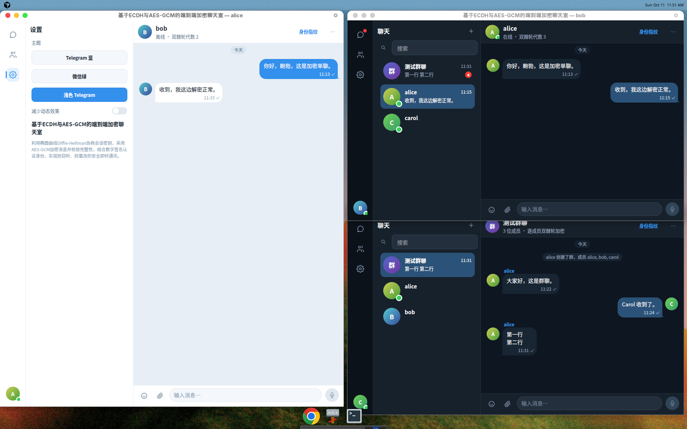

终端客户端还是 rich 界面，和桌面端共用 `ChatEngine`。底部始终有一行带边框的输入框，提示符是 `> `，后面跟着光标，不会在空白处直接打字。

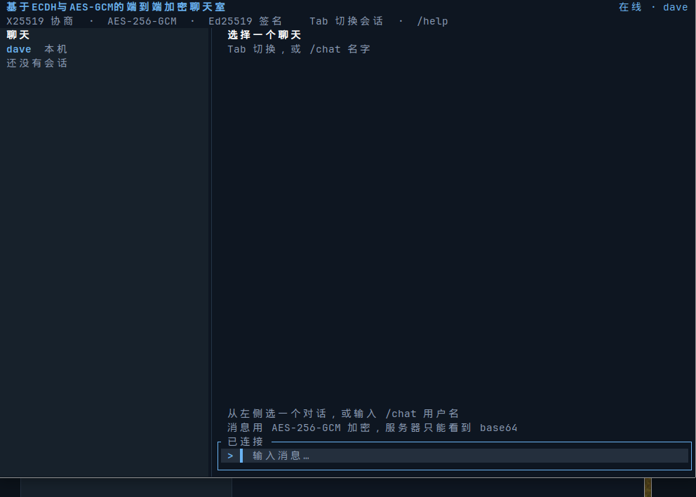

## 桌面上怎么找人、拉群、发文件

这一节只讲桌面端怎么操作，以及这些操作背后仍然走哪一套加密。界面代码在 `src/gui/people.py` 和 `src/gui/main_window.py`。点下去之后真正建会话、签群状态、发文件钥匙的仍是 `ChatEngine`，界面线程不算共享秘密。

### 联系人页

最左图标栏第二项是联系人。点进去之后，中间这一栏不再是按时间排的会话，而是一本通讯录。

排法固定：

1. **群聊**放在最上面，标题就是「群聊」。这里只列你已经在里面的群。点一个群，回到聊天页并打开它。
2. 其余联系人按用户名首字母分节。`bob` 在 B，`carol` 在 C。用户名只允许字母、数字和下划线，所以数字或下划线开头的人归到 `#`。
3. 右侧有一条细字母索引。按住它可以上下滑，列表会跳到对应的那一节，屏幕中间会短暂闪出当前字母。

每一行是头像、用户名和一行小字。人在线上写「在线」，不在线上写「离线」；已经建立过棘轮会话的人还会多标「聊过」。在线的人右下角仍是那颗绿点。

名单从哪里来：服务器的用户目录、当前在线的人、本机已经聊过的会话，以及各个群里的成员。自己的名字不会出现在这本通讯录里。对方还没注册，搜也搜不到。

侧栏搜索框在联系人页的占位文字是「搜索联系人」。它匹配的是名字里的任意一段，不区分大小写。输入 `da` 就能看见 `dave`，不必把 `dave` 四个字母打完。没有命中时，列表换成「没有匹配的联系人」。一本空通讯录则写「通讯录还是空的」。

点一个人，客户端向引擎提交 `open_chat`。如果还没有和这个人建过会话，引擎会去拉他的预密钥包，走现有的 X3DH（双方都有后量子密钥时走混合 PQXDH），然后打开单聊。这和在终端里输入 `/chat 名字` 是同一条路径，只是不用把名字敲完整。

### 发起单聊和发起群聊

侧栏右上角的加号有两项：「发起聊天」和「发起群聊」。两项都打开选人窗口，不再弹出要手填完整用户名的输入框。

发起聊天时，窗口里只有通讯录和搜索。点一个人，窗口关掉，单聊打开。搜索框里如果只剩一个匹配的人，按回车等同于点他。

发起群聊时多三样东西：

- 一个群名称输入框。可以留空。留空时，名字用已选成员拼出来：最多取前三个用户名，中间用顿号连接；超过三个人再加一个「等」。结果最长 32 个字符。例如勾了 `bob` 和 `carol`，群名就是 `bob、carol`。自己打了名字，就用打的那一个。
- 一排已选头像。每选中一个人，上面多一个圆块，里面是名字的首字母。点这个圆块就取消。换一个关键词继续搜时，刚才勾上的人还在，不会因为被筛出列表就丢掉。
- 底部的「完成」。一个人都没勾时它是灰的；勾了人之后写成「完成（人数）」。

群的人数上限没变：算上创建者最多 8 人，所以这个窗口最多再勾 7 个别人。第 8 个勾不上去，下面会提示「一个群最多再加 7 人」。群名长度必须是 1 到 32，并且不能以 `/` 开头，否则点完成时会直接提示，不会发给服务器。用户名仍是 3 到 20 位字母、数字和下划线，选人窗口里出现的名字都已经过这一关。

点完成之后，引擎做的事和终端 `/group create 群名 成员…` 相同，并不是只在服务器上记一笔名单：

1. 用创建者的 `IK_sign` 签署纪元 1 的群状态。状态里绑着群名、创建者和完整成员表，前驱哈希为空。
2. 服务器先验这个签名，再把成员表和这条状态存下来，然后把带 `state` 的 `group_update` 发给每个成员。
3. 创建者再给其他成员各发一封棘轮信封，正文是「谁创建了群、成员有哪些」，密文里带着这条群状态的 `gstate`。

所以界面上少打几个字母，不改变群状态必须签名这件事。成员表怎么防伪造，写在[群成员名单是怎么防伪造的](#群成员名单是怎么防伪造的)。终端没有这本选人通讯录，`/group create` 和 `/group add` 仍然要写完整用户名。

### 发出去之前的文件预览

文字还是直接进输入框。图片、视频和其他文件要先在输入栏上方过一张预览卡，确认之后才发送。加密方式没有因为这张卡片改变，分块、钥匙和 32MiB 上限写在[图片、视频和文件](#图片视频和文件)。

三种放进去的办法：

- 点输入栏左边的回形针，在系统文件框里选一个文件。
- 把文件拖进聊天区。一次只收一个；拖进多个时提示「一次发一个文件」，并采用第一个。
- 剪贴板里是一张图片、而且没有同时带着文字时，粘贴会把这张图存成临时 PNG 再放上预览卡。剪贴板里主要是文字时，粘贴仍然只贴文字。

卡片从左到右是：圆角封面、文件名、一行说明、关闭按钮。

- 图片按封面裁切，铺满 56 像素的圆角方块，长边多出来的部分切掉。
- 视频没有封面帧时，方块是深色底加一个白色播放三角。
- 其他文件是主题色方块加回形针。
- 说明写成「图片 · 大小」「视频 · 大小」或「文件 · 大小」。文件名太长会在卡片里省略，鼠标停上去仍能看到全名。

关掉这张卡，待发送的文件就清空，不会进棘轮，也不会上传密文。设置里打开「减少动态效果」时，卡片立刻出现、立刻消失；否则高度大约用 180 毫秒滑出和收回。换主题时，封面的主题色和图标颜色跟着换，已经裁好的图片封面保留。

文件大于 32MiB，在预览之前就拒绝，提示「文件超过 32MiB，发送前已拒绝」。找不到路径也一样，不会造出一张空卡片。

预览还在的时候，输入框里的字会当成这则文件的说明一起发出去。点发送之后，气泡先在本机出现，状态是发送中，并显示进度。图片在气泡里直接显示，视频带播放标记，其他文件显示文件名、大小和「打开」。发送失败时，红色感叹号可以重试；重试沿用原来的文件钥匙和棘轮信封，不会因为点了一次重试就再推进一格棘轮。对方打开文件之前，客户端先验棘轮信封，再逐块验 GCM，最后核对整文件的 SHA-256。任何一步失败，历史里不留下半截文件。

服务器在这一步仍然只看到密文分片的编号和长度。预览卡上的文件名、封面和文件钥匙都不上传。历史里保存的是说明、摘要和本机路径，不保存文件钥匙。

## 五分钟跑起来

需要 Python 3.11+。依赖只写在 `requirements.txt`：`cryptography`、`websockets`、`rich`、`PySide6`、`pytest`。

```bash
python3 -m pip install -r requirements.txt
```

先开服务器，再开三个客户端。演示口令一律是 `password123`。

```bash
python3 -m src.server --host 127.0.0.1 --port 8765 --db data/server.db
```

桌面端可以只开登录窗，也可以把用户名和口令一起带上，一次摆开三个窗口：

```bash
python3 -m src.gui --user alice --password password123 --host 127.0.0.1 --port 8765 --db data/alice.db --geometry 960x880+12+12
python3 -m src.gui --user bob --password password123 --host 127.0.0.1 --port 8765 --db data/bob.db --geometry 920x880+990+12
python3 -m src.gui --user carol --password password123 --host 127.0.0.1 --port 8765 --db data/carol.db --geometry 920x880+12+40
```

不写 `--db` 时，数据库是 `data/用户名.db`。`--geometry` 是 `宽x高+横坐标+纵坐标`，方便同一块屏幕上并排看。

三个窗口都在线之后，在 alice 这边按这个顺序点：

1. 左侧联系人。应能看到按字母分开的 bob、carol。搜索框输入 `bo`，列表只剩 bob。点 bob，打开和他的加密单聊。
2. 回到联系人，点右上角加号，选「发起群聊」。搜索 `bo` 勾上 bob，再搜索 `ca` 勾上 carol。群名留空，点「完成」。聊天页应打开名为 `bob、carol` 的群，系统消息写明 alice 创建了群、成员是 alice、bob、carol。bob 和 carol 的会话列表里也会出现这个群。
3. 在这个群里点回形针，选一张图片。输入栏上方出现圆角预览，写着「图片」和大小。点预览上的关闭，图片不会发出去。再选一次，输入框里写一句说明，点发送。对方气泡里能直接看到这张图；服务器日志里只有文件编号和字节数，没有文件名，也没有这句说明。

终端版对应的是：

```bash
python3 -m src.client --user alice --password password123 --host 127.0.0.1 --port 8765
python3 -m src.client --user bob --password password123 --host 127.0.0.1 --port 8765
python3 -m src.client --user carol --password password123 --host 127.0.0.1 --port 8765
```

第一次启动会在本机生成身份钥匙、签名预密钥和 20 把一次性预密钥。公钥上传，私钥留下。

Alice 和 Bob 的终端单聊：

```text
/chat bob
/fingerprint bob
你好鲍勃
```

Bob 回复 `你好爱丽丝` 时，发生第一次由回复触发的 DH 棘轮更换，界面上的棘轮代数加一。一个人先连续说几句、对方才回，更换发生在对方那一条回复上；一人一句马上回，就是第 2 条消息。

三人小群：

```text
/group create 三人组 bob carol
群里大家好
```

Bob 和 Carol 各自收到发给自己的那一封。Carol 解不开 Alice 发给 Bob 的单聊信封。

其它命令：

```text
/users
/history
/group add 三人组 新成员
/fingerprint 名字
/pq status 名字
/file 路径
/theme telegram
/theme wechat
/help
/quit
```

终端底部那一行带边框的输入框里打字，回车发送。输入框为空时，Tab 或上下键切换会话。窄终端会自动收起侧栏。

## 系统是怎么分层的

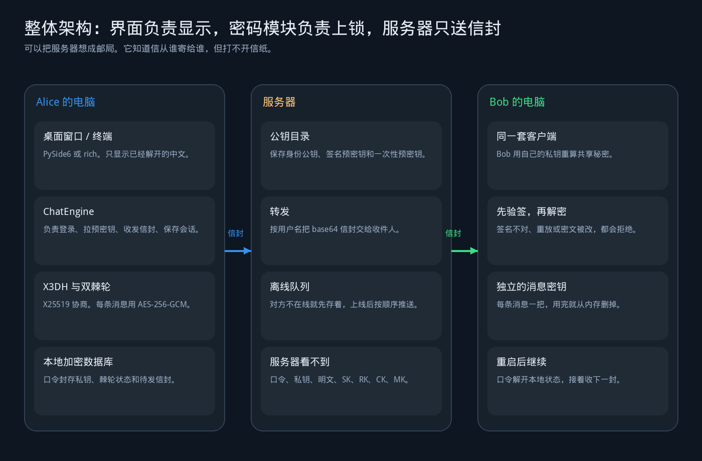

从上到下只有四层，每层有明确不能做的事。

1. **界面层**只负责看和点。桌面端在 `src/gui/`，终端端在 `src/ui.py`。Qt 主线程不计算共享秘密，也不保存链钥匙。耗时的口令派生和网络收发放在独立线程里的 asyncio 循环中，所以解锁数据库时窗口还能动。
2. **会话引擎**是 `src/client.py` 里的 `ChatEngine`。它决定何时注册、何时拉预密钥包、何时为某个朋友建立棘轮、何时把群消息拆成多封信。桌面端和终端端调用的是同一个引擎。
3. **密码模块**是 `src/x3dh.py`、`src/double_ratchet.py`、`src/prekeys.py`。这三个文件不许导入网络和数据库，输入输出都是字节，单测可以不连网。
4. **服务器**是 `src/server.py` 加 `src/store.py` 里的 `ServerStore`。它保存公钥、签名、一次性预密钥池、群成员名单和离线信封，按用户名转发。它不解析出明文。

网上跑的是带 `type` 的 JSON，单条超过 64KB 就拒绝。至少有这些类型：`register`、`login_challenge`、`login`、`upload_prekeys`、`fetch_bundle`、`envelope`、`error`。实际还会用到 `fetch_user`、`list_users`、`presence`、`group_create`、`group_add`、`group_info`、`group_update`、`group_sync`，以及附件密文的 `blob_begin`、`blob_chunk`、`blob_finish`、`blob_fetch`、`blob_done`。请求带 `request_id`，这样两个请求同时回来也不会拿错回包；聊天推送不带这个关联编号。

一条信封里给人看的头是明文的：当前棘轮公钥 `dh_pub`、本链序号 `n`、上一链发了多少条 `pn`，再加上 12 字节随机 nonce 和 base64 密文。本项目故意不再给头加一层加密，避免协议做跑偏。头公开不等于正文公开，因为没有消息钥匙就解不开 AES-256-GCM。

## 图片、视频和文件

文字还是一条棘轮消息。图片、视频和普通文件不塞进这封信，也不把 64KB 的帧上限抬高。客户端另外生成 32 字节文件钥匙，按 24KiB 一块做 AES-256-GCM。12 字节 nonce 的前 8 字节随机，后 4 字节是块序号；附加数据绑上文件编号、块序号和总块数，所以块不能对调，钥匙也不会拿到另一个文件上复用。明文 SHA-256、文件名、类型、大小和块数，跟这把钥匙一起放进现有内层 JSON（`kind` 为 `file`），再由这一条消息的 `MK` 加密。服务器只保存密文分片，日志里只有文件编号和长度。

单文件上限是 32MiB，更大的在发送前就拒绝，避免把离线队列和内存撑满。24KiB 明文加上 16 字节认证标签，再做 base64，连同 JSON 头仍然小于 64KB，所以能走原来的 WebSocket 帧。群里同一份密文只上传一次，其他成员每人仍收一封自己的棘轮信封，信封里是同一把文件钥匙。收件人先验信封，再逐块验 GCM，拼完核对整文件摘要。任一块失败就整份丢掉，历史里不留半截文件。

桌面端先在输入栏上方放一张预览卡，确认后才发送。选文件、粘贴图片、拖进会话、取消和进度都写在[桌面上怎么找人、拉群、发文件](#桌面上怎么找人拉群发文件)。终端没有预览卡，当前会话里用 `/file 路径`，路径要写完整，命令本身不带说明文字。收到的文件写在本机附件目录，历史里只留说明和摘要。群文件的钥匙信封带上当前群状态的 `gstate`。棘轮若已经混入后量子封装，这封钥匙信封走同一条混合链。

## 每个人手上有哪些钥匙

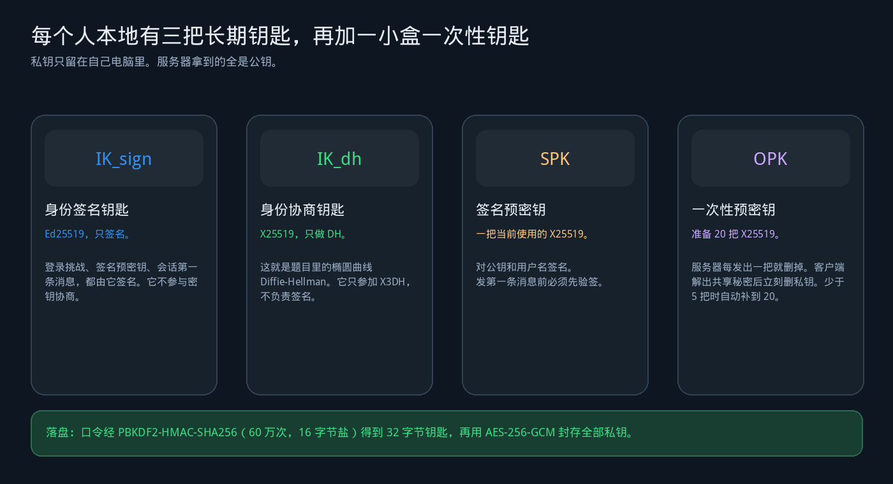

注册时在客户端生成，不在服务器生成。

- **IK_sign** 是 Ed25519。它像图章，只能证明「这是我签的」，不能用来和别人算出共享秘密。
- **IK_dh** 是 X25519。它像一把长期的协商钥匙，只出现在 X3DH 里。
- **SPK** 是当前这把签名预密钥，也是 X25519。图章盖的内容是 `SPK 公钥原始字节 || 用户名`，旁边记下创建时间。服务器入库前先验这个签名，验不过就拒绝注册。对方发来第一条消息前也要先验，失败时界面提示「对方预密钥签名无效」。
- **OPK** 是一次性预密钥，一开始 20 把。服务器每发给一个人就从池子里删掉那把公钥，不能再发给下一个人。接收方用对应私钥算完共享秘密，并且第一条密文认证成功之后，立刻删除这把私钥。本地剩下不到 5 把时，客户端再生成，补满 20 把，并把新公钥上传。
- **PQK** 是 ML-KEM-768 后量子密钥，只做封装，不签名。公钥由 `IK_sign` 签名后放进 bundle，供对方做混合握手和混合棘轮的重新封装。私钥与其他密钥一起封进口令加密的保险库。

用户名是唯一的，只允许 3 到 20 位字母、数字和下划线。没有邮箱，也没有短信。

私钥落盘的方式固定：口令用 PBKDF2-HMAC-SHA256 做 600000 次，盐是 16 字节，得到 32 字节钥匙，再用 AES-256-GCM 加密身份私钥、SPK 私钥、还没用掉的 OPK 私钥，以及棘轮会话状态。服务器碰不到口令。

## 注册和登录在证明什么

注册不是让服务器「记住你的密码」。服务器根本没有口令。注册是在公布三样可以公开的东西：两把身份公钥，以及第一把已经签过名的 SPK，外加 OPK 公钥。服务器用 `IK_sign` 验 SPK，确认这把预密钥确实属于这个用户名。

登录是挑战应答。服务器发 32 字节随机数，客户端用 `IK_sign` 私钥签名，服务器用登记过的公钥验签。签得过，就说明连接的另一头拿着当时注册的那把身份私钥。这仍然不能代替线下核对指纹：如果第一次注册时服务器就把公钥换成了别人的，挑战应答只能证明「你拿着服务器当初收下的那把私钥」。

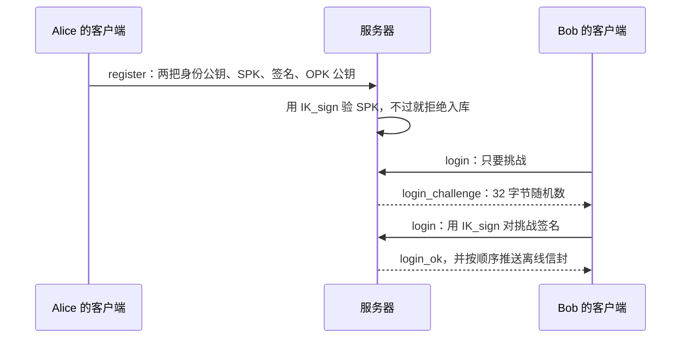

## 第一条消息如何算出同一把 SK

Alice 给 Bob 发这个会话的第一条消息之前，先向服务器要 Bob 的 bundle：`IK_dh`、`IK_sign`、`SPK`、SPK 签名，有剩余 OPK 就弹出一把。没有 OPK 就省略，双方少算一次 DH，但仍然要得到同一个 `SK`。

Alice 先验 SPK 签名。然后她生成一把只用这一次的临时 X25519 钥匙 `EK_A`。

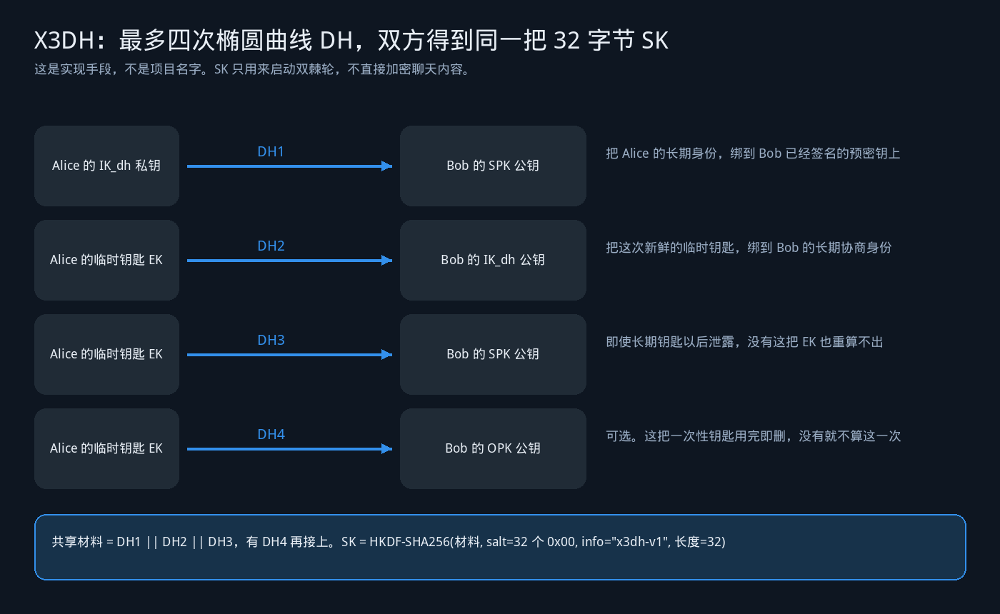

四次 DH 可以记成四句人话：

- **DH1** 把 Alice 的长期协商身份绑到 Bob 签过名的预密钥上。服务器不能随便塞一把没有 Bob 签名的 SPK。
- **DH2** 把 Alice 这次新生成的临时钥匙绑到 Bob 的长期协商身份上。
- **DH3** 再让这把临时钥匙和 Bob 的 SPK 算一次。以后即使长期身份钥匙泄露，没有当时的 `EK_A`，也重算不出这一次的材料。
- **DH4** 只有拿到 OPK 才算。它让这一次握手用掉 Bob 的一把一次性钥匙。Bob 的私钥用完就删，服务器上的那把公钥也已经发过就删。

共享材料是 `DH1 || DH2 || DH3`，有 DH4 就再接上，所以长度一定是 32 的倍数。然后：

```text
SK = HKDF-SHA256(
    ikm = 共享材料,
    salt = 32 个 0x00,
    info = b"x3dh-v1",
    length = 32
)
```

Bob 不用把 Alice 的私钥要过来。他把角色对调：自己的 SPK 私钥配 Alice 的 `IK_dh` 公钥，自己的 `IK_dh` 私钥配 `EK_A` 公钥，自己的 SPK 私钥再配 `EK_A`，有 OPK 就用 OPK 私钥配 `EK_A`。两次算出的 `SK` 必须逐字节相同。单测同时覆盖「有 OPK」和「没有 OPK」。

第一条消息还附带 Alice 的 `IK_dh` 公钥、`EK_A` 公钥、用掉的 OPK 公钥（没有就是空），以及 `IK_sign` 对这几段字节的签名。Bob 先验这个签名，再核对 Alice 的身份协商公钥和服务器登记的是不是同一把。对不上就拒绝，不进入解密。

客户端第一次见过对方的两把身份公钥之后会固定下来。以后 bundle 里的身份公钥变了，提示身份密钥发生变化，拒绝覆盖已经见过的指纹。

## 这条握手的后量子扩展已经做了

Fiedler 和 Günther 在 PKC 2025 分析的 PQXDH，是在上面这四次 Diffie-Hellman 之外再并入一次后量子密钥封装。Signal 部署用 Kyber，论文也处理 ML-KEM。封装那一项用来挡住「现在记下握手，以后量子计算机打破 X25519」。对外介绍把这篇称作 *PQXDH: A Post-Quantum Extension of X3DH*；正式题名是 *Security Analysis of Signal's PQXDH Handshake*。全文在 [docs/papers/2024-702-fiedler-guenther-pqxdh.pdf](docs/papers/2024-702-fiedler-guenther-pqxdh.pdf)。

本仓库实现了这条路径，并且把 Signal 规范里的一次性封装公钥也做上了。每个人注册时除了三把长期钥匙，还生成一把 ML-KEM-768 长期密钥 `PQK`，再生成 8 把一次性 `PQOPK`。长期公钥由 `IK_sign` 对（PQK 公钥 || 用户名）签名；一次性公钥的签名输入多一个前缀 `pq-opk-v1`，不能拿去冒充长期钥（`src/prekeys.py` 的 `generate_mlkem768`、`sign_pq`、`sign_pq_opk`）。

发起新会话时向服务器要一把 `PQOPK`（`fetch_bundle` 带 `consume_pq_opk`）。有就把 KEM 封装到它上面；服务器没给，才封装到签过名的长期 `PQK`。补拉长期公钥做棘轮升级时不带这个标志，避免把一次性池子烧掉。得到共享秘密 `ss` 和密文 `PQ_CT` 之后：

```text
SK = HKDF-SHA256(
    ikm = DH1||DH2||DH3[||DH4] || ss || SHA-256(封装公钥),
    salt = 0^32,
    info = b"pqxdh-v1",
    32
)
```

对应的函数是 `src/x3dh.py` 的 `initiator_hybrid_secret` / `responder_hybrid_secret` / `hkdf_pq_sk`，经典 `x3dh-v1` 路径保留，域标签分开。封装公钥的哈希放进 `ikm`，一次性公钥和长期公钥不能互换。初始消息的 `IK_sign` 覆盖 `IK_dh || EK || OPK || IK_PQ || PQ_EK || PQ_CT`。换掉密文或封装公钥，验签即失败。首条 GCM 成功之后，接收方才删除用掉的 `PQOPK` 私钥；池子少于 2 把时补到 8 把再上传。两端都支持 PQ 时，客户端拒绝没有 PQ 的经典握手，服务器不能把 KEM 整个拿掉。它能做的是扣留一次性钥，迫使这次握手落到长期 `PQK`。终端 `/pq status 名字` 会写明这次用的是 `pqopk` 还是 `pqk`。

混合棘轮换链时仍然封装到长期 `PQK`，不封装到已经删除的一次性钥。长期 `PQK` 以后泄露，握手若用过一次性钥并且私钥已删，这次 `SK` 仍算不出来；泄露之后的新棘轮链则退回经典 DH 的保障。

没有把 X25519 的输出说成后量子，也没有实现 Kyber——用的是标准化后的 ML-KEM-768，由 Python `cryptography`（需要 44.0+）提供。同一把长期公钥上的封装和解封会缓存密钥对象，避免每次换链都 `from_seed_bytes`。

## 为什么后面每条消息还要换钥匙

如果 `SK` 直接加密所有聊天，那么 `SK` 一旦泄露，历史和未来全都能解开。双棘轮把 `SK` 只当成启动根钥匙，后面分成两种「往前滚」：

- **对称棘轮**解决同一把棘轮公钥下面的连续消息。
- **DH 棘轮**解决「对方已经回复，双方都换了新的临时棘轮公钥」之后的恢复。

对称棘轮 `KDF_CK(ck)`：

```text
MK  = HMAC-SHA256(key = ck, msg = 0x01) 的 32 字节
新 CK = HMAC-SHA256(key = ck, msg = 0x02) 的 32 字节
```

`MK` 是这一条消息的 AES-256-GCM 钥匙。用完就从结构里删掉，不写日志。同一把 `dh_pub` 下连续两条消息只走对称棘轮，所以两把 `MK` 不同，但头里的棘轮公钥相同。

DH 棘轮 `KDF_RK(rk, dh_out)`：

```text
out = HKDF-SHA256(ikm = dh_out, salt = rk, info = b"dr-v1", length = 64)
新 RK = out 的前 32 字节
新 CK = out 的后 32 字节
```

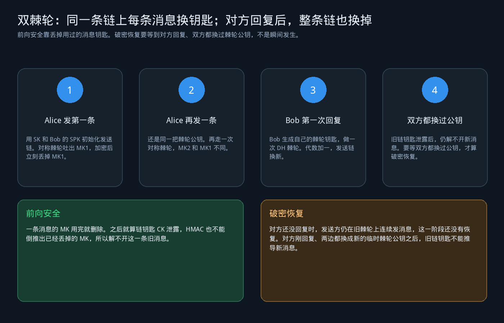

初始化的顺序是固定的：

1. Alice 算完 `SK`，生成第一把发送棘轮钥匙 `R_A`。
2. 她计算 `X25519(R_A 私钥, Bob 的 SPK 公钥)`，再 `KDF_RK(SK, 这次 DH)`，得到根钥匙 `RK` 和发送链 `CKs`。接收链先空着。序号 `Ns`、`Nr`、`PNs` 都从 0 开始。这一步已经算一次 DH 棘轮，代数记为 1。
3. Alice 发第一条聊天消息时再做一次对称棘轮。头里 `dh_pub` 是 `R_A` 公钥，`n = 0`，`pn = 0`。
4. Bob 用自己的 SPK 私钥和头里的 `R_A` 做同样的 DH 和 `KDF_RK`，得到接收链，再按 `n` 取出 `MK` 解密。
5. Bob **第一次回复之前**才生成自己的 `R_B`。他先把当前接收链已经走到的长度记进 `PNs`，再计算 `X25519(R_B 私钥, R_A 公钥)`，用 `KDF_RK` 换出新的发送链，`Ns` 归零，代数加一。
6. Alice 收到一把没见过的 `dh_pub` 时，先把旧接收链上被跳过的序号补出来，再生成自己的下一把棘轮钥匙，做 DH 棘轮，换掉发送链。

所以「代数加一」在界面上最容易看到的时刻，是对方第一次回复到达的时候。对方还没回，Alice 可以继续用同一把 `R_A` 发很多条，那些条只换 `MK`，不换 DH 钥匙。

加密时的附加认证数据不是装饰。它把这些字段绑进 GCM 标签：

```text
发送方用户名 UTF-8
|| 接收方用户名 UTF-8
|| N 的 4 字节大端
|| PN 的 4 字节大端
|| 本方当前棘轮公钥原始字节
```

有人把密文挪到另一条会话、改序号，或者换成另一把棘轮公钥，标签都会失败。

**前向安全**讲的是过去：这条消息的 `MK` 已经丢掉。后面的链钥匙再泄露，也倒推不回这把 `MK`，因此解不开这条已经发出的消息。

**破密恢复**讲的是将来，而且不要说成「一泄露就立刻恢复」。准确的时间点是：对方刚回复，双方都换过棘轮公钥之后。旧的链钥匙推不出新的 DH 输出，也就解不开回复之后的新消息。回复发生之前，发送方还在旧链上，这一段还没有 DH 棘轮意义上的恢复。

Bienstock 等人在 CRYPTO 2022 用通用可组合功能 `F_DR` 分析的就是这套双棘轮。对外介绍把它称作 *A Universally Composable Analysis of the Double Ratchet*；正式题名是 *A More Complete Analysis of the Signal Double Ratchet Algorithm*。`kdf_ck` 是他们的对称棘轮，`kdf_rk` 是 DH 棘轮，`_skip_message_keys` 是乱序和丢包仍能解开的立即解密，`encrypt` / `decrypt` 不把用过的消息钥匙留在状态里。他们同时指出一个本仓库仍然留着的窗口：发送棘轮私钥 `dhs_priv` 要留到对方下一把公钥到来，这段时间里连续两次取走状态，可以拼出本轮已经发出的消息钥匙。补上这个窗口的 Triple Ratchet 没有实现。全文在 [docs/papers/2022-355-bienstock-etal-double-ratchet.pdf](docs/papers/2022-355-bienstock-etal-double-ratchet.pdf)。

## 每条换链为什么还混入后量子封装

握手混合了 PQ，棘轮也要混合，否则「先记录握手密文」换成了「先记录棘轮密文」，量子对手换个目标而已。混合棘轮的规则是：**每一把新发送链都再混入一次新鲜的 ML-KEM 共享秘密**。

开新链的一方（第一次发送或每次回复）在算出 DH 输出之外，再对对方的长期 `PQK` 公钥封装一次：

```text
新 RK || 新 CK = HKDF-SHA256(ikm = dh_out || ss, salt = rk, info = b"pq-dr-v1", 64)
```

封装密文 `pq_ct` 随这条链的每条消息外带（信封 JSON 里的 `pq_ct` 字段），收链的一方用自己的 `PQK` 私钥解封后按同一个 `kdf_rk_pq` 得到同一条链。实现是 `src/double_ratchet.py` 的 `kdf_rk_pq`，与经典 `dr-v1` 域分离；`init_sender`、`init_receiver`、`_prepare_sending_chain`、`_dh_ratchet` 在有对端 `PQK` 时都走混合路径。双方都已记录对端 `PQK` 之后，新链缺 `pq_ct` 直接拒绝——中间人剥掉封装把棘轮降级回经典是行不通的；换一个字节的 `pq_ct`，解封或 GCM 都会失败。

旧会话的迁移是渐进的：启动时没有对端 `PQK` 的会话，在收发前自动补拉 bundle 并核验 PQK 签名（`ChatEngine._upgrade_pq_key`），之后的链全部混合。升级之前的旧消息仍是经典密文，记录后可用量子计算机打破；升级之后不再依赖 X25519 的抗量子性。终端用 `/pq status 名字` 查看握手类型和棘轮是否已混入 PQ。注意这不是 Triple Ratchet：`dhs_priv` 的窗口照旧，`PQK` 是长期密钥，每次只是对它重新封装。

## 乱序、重放和篡改

网络不保证先发先到。收到的序号 `n` 如果比期望序号大，就把中间那些还没到的 `MK` 算出来，放进跳过缓存。缓存键是 `dh_pub || n`，最多 40 把。再多就拒绝，避免别人发一个巨大序号，逼客户端算出成千上万把钥匙。

这 40 把里面的某一条稍后到达，就取出对应 `MK` 解密，然后立刻从缓存删除。已经成功处理过的 `(dh_pub, n)` 再出现，直接拒绝，这是防重放。不必再让 GCM 去「试试看」。

改一个密文字节，或者改 nonce、改附加数据，GCM 认证失败，界面提示「GCM 失败」。解密先在棘轮状态的副本上进行，认证成功才提交。伪造包不能把后面那条合法消息的钥匙提前烧掉。OPK 私钥也同样拖到第一条密文认证成功之后再删。

群名和消息类别除了写在外层信封，还复制进密文。解密后两边不一致就拒绝，避免服务器改了外层字段，让一条单聊在界面上伪装成群消息。

## 不核对指纹时服务器能做什么

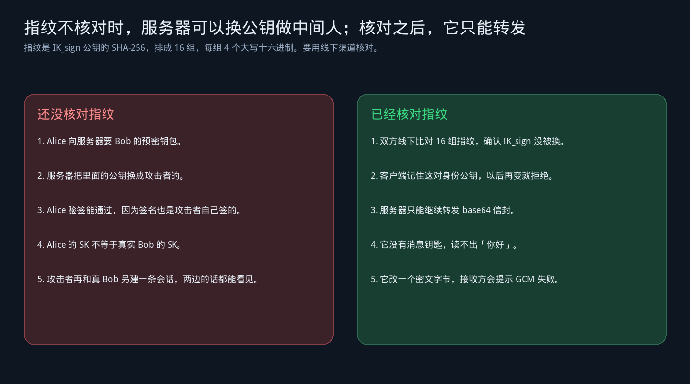

预密钥目录放在服务器上。Alice 如果不核对 Bob 的指纹，服务器可以在 `fetch_bundle` 时把 Bob 的公钥换成攻击者的，再配上一把攻击者自己能签过的 `IK_sign`。Alice 会和攻击者算出 `SK`；攻击者再去和真实的 Bob 另建一条会话。两边看到的中文都是攻击者转发的。这就是中间人。

指纹是 `IK_sign` 公钥的 SHA-256，显示成 16 组，每组 4 个大写十六进制。桌面端点「身份指纹」，终端用 `/fingerprint 名字`。双方用线下渠道核对。核对过之后，服务器再换公钥会被客户端拒绝。从此它只能转发信封：没有 `MK`，读不出正文；改一个字节，接收方 GCM 失败。

`scripts/demo_attack.py` 在内存里演示这件事，不需要连网：

```bash
python3 scripts/demo_attack.py
```

它会打印：诚实 bundle 下 Alice 和 Bob 的 `SK` 相同；公钥被掉包后，Alice 的 `SK` 不等于真实 Bob，却等于攻击者重算的 `SK`。

## 三个人的群聊是怎么加密的

群最多 8 个人。一条群消息不是大家共用一把发送者钥匙。`ChatEngine.send_text` 对每个其他成员各跑那一对已经建立的双棘轮，发出多封信封。服务器按收件人分发。Bob 只能解开写着给 Bob 的那封，Carol 只能解开写着给 Carol 的那封。

Rösler、Mainka 和 Schwenk 在 EuroS&P 2018 指出，Signal 和 WhatsApp 当时的群先用两人会话分发 Sender Key，群正文再走发送者自己的对称链，两人双棘轮上的 future secrecy 到不了这条群链。逐人信封是对这个威胁分析的回应：每一封仍有那一对的前向安全，对方回复并换过棘轮公钥之后也仍有破密恢复。正式题名是 *More is Less: On the End-to-End Security of Group Chats in Signal, WhatsApp, and Threema*；对外介绍收成 *More is Less: On the Security of Instant Messaging Groups*。全文在 [docs/papers/2017-713-rosler-etal-group-chats.pdf](docs/papers/2017-713-rosler-etal-group-chats.pdf)。

人数增加，信封数量线性增加，因此 `MAX_GROUP_MEMBERS` 是 8。这不是 MLS。新成员只进入之后的新消息；旧消息不会补发给他，因为他没有那些已经丢掉的消息钥匙。

## 群成员名单是怎么防伪造的

成员名单仍然存在服务器上，但不再是服务器说了算。EuroS&P 2018 指出的「群管理没有端到端保护」，本仓库补成**带签名、哈希链接的群状态**（`src/groups.py`）：

- 创世状态（纪元 1）由创建者用 `IK_sign` 签名，绑定群名、创建者、完整成员表和空前驱。
- 每次拉人是一条新状态：纪元加一，成员表只增一人，前驱哈希必须指向上一状态，签署者必须是上一状态的成员。服务器入库前验签，客户端收到 `group_update` 时再独立验一遍。
- 群消息的密文里带 `gstate` = 发送者所用群状态的 SHA-256。接收方只接受「该状态在已验证链上、且发送者在该状态成员表里」的消息。

这三条合起来：服务器伪造不了任何成员表（没有合法成员的签名），往群里塞幽灵成员、或者给两名成员看两份不同的名单，都会在客户端被拒或通过哈希链断开暴露；它剩下的能力只有漏投，而漏投会被 `group_sync` 补链发现。演示脚本：

```bash
python3 scripts/demo_group_attack.py
```

会打印四种情形：创世状态通过、非成员签名拉人被拒、用真签名删成员被拒（成员只增不减）、合法成员拉人通过。仍未覆盖的部分照旧：没有成员入群同意的端到端协商，没有群签名让成员互证，也不是 MLS。

## 关掉再打开，为什么还能接着聊

客户端 SQLite 里有两块不同的数据。

- 历史正文、未读数、主题和当前会话是界面状态，留在本机，方便搜索和重开窗口。搜索只查本机已经解开的历史，用参数化 `LIKE`，不会把明文发给服务器。
- 身份私钥、棘轮里的 `RK`、链钥匙、棘轮私钥、跳过的 `MK`，以及还没确认发出去的信封，都放进口令加密的 blob。

发送时先把「推进后的棘轮状态」和「完整信封」放进同一个数据库事务。如果程序在发出去之前崩溃，下次登录会重发原来那封，而不是再推进一次棘轮、做出一封 Bob 无法对上序号的新信。桌面端会把这种消息显示成发送中、已发送或失败。失败可以看见原因，例如验签失败、重放拒绝、GCM 失败。

服务器进程重启后，SQLite 里的用户公钥、SPK、剩余 OPK 和离线信封还在。客户端重启后，用同一个口令解开棘轮，可以继续收下一封。离线消息按入队顺序推送，推成功一封删一封，避免半路断开后整段队列丢失或重复删除。

## 两套界面，同一套引擎

| | 桌面端 | 终端端 |
| --- | --- | --- |
| 启动 | `python3 -m src.gui`，也可用 `--user`、`--password`、`--db`、`--geometry` | `python3 -m src.client --user 名字 --password 口令` |
| 界面 | PySide6 三栏。三套主题，会话列表和气泡都是自绘 | rich 双栏。底部带边框的输入行。窄屏幕自动变成单栏 |
| 找人 | 联系人按字母分节，搜索名字中的一段。点一个人打开单聊 | `/chat 名字`，名字要写完整 |
| 拉群 | 加号里勾选成员，群名可留空。最多再加 7 人 | `/group create 群名 成员…`，成员名要写完整 |
| 文件 | 回形针、粘贴图片或拖入。先出预览卡，关闭则不发送 | `/file 路径` |
| 发送 | Enter 发送，Shift+Enter 换行。先在气泡里显示「发送中」 | 输入框里打字，回车发送。提示符是 `> ` |
| 安全提示 | 红色安全气泡和顶部连接条 | 红色的「验签失败 / 重放拒绝 / GCM 失败」 |
| 密码协议 | 不单独实现，调用 `ChatEngine` | 同一个 `ChatEngine` |

桌面端断线后会自动重连。重连成功只补发还留在加密 outbox 里的原始信封。群消息的扇出如果只成功了一部分，历史里会留下「送达了几个收件人」，不会假装全员都收到了。

## 建议的读码顺序

答辩前按这个顺序读，每一段都能指着文件讲：

| 顺序 | 文件 | 读它是为了讲清什么 |
| --- | --- | --- |
| 1 | `src/x3dh.py` | 四次 X25519、HKDF 标签 `x3dh-v1`、初始消息签名 |
| 2 | `src/double_ratchet.py` | `0x01` / `0x02`、`dr-v1`、AES-256-GCM、40 条跳过上限、原子提交 |
| 3 | `tests/test_x3dh.py`、`tests/test_double_ratchet.py` | 双方 `SK` 相同、回复后代数加一、乱序、重放、篡改 |
| 4 | `src/prekeys.py` | 三把长期钥匙分离，OPK 用完即删，少于 5 把补到 20 |
| 5 | `src/protocol.py` | 信封、指纹、64KB、用户名规则 |
| 6 | `src/server.py` | 验签后才入库、OPK 只发一次、离线队列、日志不出现明文 |
| 7 | `src/store.py` | PBKDF2 600000 次和 AES-256-GCM 封存 |
| 8 | `src/client.py` | 把上面的零件串成注册、登录、单聊和群扇出 |
| 9 | `src/gui/` | 展示层。联系人和选人在 `people.py`，发送前的文件卡片在 `main_window.py`。可以最后看，它不改变密码协议 |

更完整的课程报告在 [REPORT.md](REPORT.md)。报告标题和摘要与本文件相同，正文按答辩口径写了前向安全、破密恢复和中间人。

## 测试时应该看到什么

```bash
python3 -m pytest -q
```

不连网的单测覆盖：

- 有 OPK 和没有 OPK 时，双方 `SK` 完全一致
- 往返各 3 条，明文一致
- 同一把 `dh_pub` 下两条消息的 `MK` 不同
- 回复后 DH 棘轮代数加一，更换前后 `MK` 不同
- 故意打乱到达顺序仍能解开
- 同一封再放一次被拒绝
- 改一个密文字节，GCM 失败，而且失败不会破坏后续合法消息
- 中间跳过超过 40 条被拒绝
- 换到新 DH 链之后，旧链里按 `PN` 缓存过的迟到消息仍能解开

联网测试覆盖中文单聊、离线队列、三人群、Carol 解不开 Alice 给 Bob 的信封、重放和篡改。存储测试覆盖口令重新解开棘轮后继续解密。

手测时可以用三台客户端确认四件事：服务器终端搜不到那句中文；改密文字节和重放都会被接收方拒绝；回复那一条让棘轮代数增加；重启服务器后公钥和离线信封还在，重启客户端后口令能解开状态并继续收。

## 和 Signal、WhatsApp 的差别

本仓库按课程步骤自己把协议拼起来，没有使用 libsignal 或别的现成棘轮库。和那两套产品相比，故意没做这些：

- **没有多设备。** 一台客户端一份加密数据库，新手机不能把旧链同步过去。
- **没有 Kyber。** 握手是 X25519 + ML-KEM-768 的混合 PQXDH，没有部署 Kyber。
- **没有密封发送者。** 信封上的发送方和接收方是明文，服务器知道谁在和谁通信，只是不知道正文。
- **没有头加密。** `dh_pub`、`n`、`pn` 可以直接看见。
- **群不是 Sender Keys。** `send_text` 按收件人各发一封双棘轮信封，所以最多 8 人。这是对 EuroS&P 2018 群威胁分析的回应；成员表由签名哈希链保护，但成员入群同意和群签名仍没有。
- **没有 Triple Ratchet。** 发送棘轮私钥会留到对方下一把公钥到来。CRYPTO 2022 指出的那个窗口还在。
- **身份钥匙不是 XEdDSA。** Ed25519 只签名，X25519 只做 Diffie-Hellman。

KDF 标签和题目一致：`x3dh-v1`、`dr-v1`、HMAC 的 `0x01` / `0x02`，附加数据是用户名和 4 字节大端序号。没有协议偏离需要单独解释。

## 论文对应哪段代码

对外介绍以三篇为主引用。正式题名更长，两套名字指向同一份 ePrint PDF。书目在 [docs/papers/references.bib](docs/papers/references.bib)，逐段说明在 [docs/papers/README.md](docs/papers/README.md)。

| 对外介绍 | 代码 | 本仓库满足的部分 | 本仓库不满足的部分 |
| --- | --- | --- | --- |
| Bienstock 等，*A Universally Composable Analysis of the Double Ratchet*，CRYPTO 2022 | `kdf_ck` 对称棘轮；`kdf_rk`、`_dh_ratchet`、`_prepare_sending_chain` 是 DH 棘轮；`_skip_message_keys` 处理乱序和丢包；`encrypt` / `decrypt` 用过消息钥匙即弃 | 双棘轮这四块积木的形状，与他们证明能实现 `F_DR` 的构造一致 | 没有在本仓库上重跑 UC 证明。`dhs_priv` 仍留在窗口里，没有 Triple Ratchet / `F_TR`。跳过缓存超过 40 把就拒绝 |
| Fiedler、Günther，*PQXDH: A Post-Quantum Extension of X3DH*，PKC 2025 | `initiator_hybrid_secret`、`responder_hybrid_secret`、`hkdf_pq_sk`；`IdentityKeys.pq_opks` | 混合 PQXDH：四次 X25519 之外并入 ML-KEM-768。握手优先用一次性 PQOPK，没有则用签过名的长期 PQK。域分离 `pqxdh-v1`，封装公钥的 SHA-256 进 HKDF，`PQ_EK` 与 `PQ_CT` 进 IK_sign | 没有 Kyber，也没有重跑他们的安全界。服务器可以扣留 PQOPK 迫使最后手段。混合棘轮仍封装长期 PQK，这把长期钥泄露后退回经典 DH |
| Rösler、Mainka、Schwenk，*More is Less: On the Security of Instant Messaging Groups*，EuroS&P 2018 | `ChatEngine.send_text` 对每个其他成员调用 `_send_one`；`src/groups.py` 的签名群状态 | 每人独立双棘轮信封，群正文不走 Sender Keys；成员表由签名哈希链端到端保护，伪造名单被拒 | 成员入群同意没有端到端协商，没有群签名，也没有做成 MLS |

正式题名分别是 *A More Complete Analysis of the Signal Double Ratchet Algorithm*、*Security Analysis of Signal's PQXDH Handshake*、*More is Less: On the End-to-End Security of Group Chats in Signal, WhatsApp, and Threema*。三份全文是 `docs/papers/2022-355-bienstock-etal-double-ratchet.pdf`、`docs/papers/2024-702-fiedler-guenther-pqxdh.pdf`、`docs/papers/2017-713-rosler-etal-group-chats.pdf`。

X25519、Ed25519、HKDF、AES-256-GCM，以及 2016 年的破密恢复定义、2017/2020 年的 Signal 多阶段证明、2019 年的棘轮拆分，仍写在同一篇文献说明里。Curve25519 的设计论文只链接到作者页面。这些 PDF 使用各自的知识共享许可，不在本仓库的 MIT 许可之下。2022 年 Bienstock 等人的那篇是署名-非商业性使用。

上面三篇的定理都没有在本仓库上重新证明。屏幕指纹不覆盖 `IK_dh`。头 `dh_pub`、`n`、`pn` 是明文。

## 本次扩展：两个研究生创新点

这一节是对比经典复现新增的部分，其余章节保持原样。两个创新点都回答「服务器不可信时 Signal 式的设计没答好的问题」。

### 创新点一：群成员名单的端到端防伪（签名群状态）

原来的成员表由服务器记录，恶意服务器可以往群里塞幽灵成员，或者给不同成员看不同的名单——EuroS&P 2018 指出的群管理端到端保护缺失。本扩展把成员名单改成**带签名、哈希链接的群状态**，核心在 [src/groups.py](src/groups.py)：

- 创世状态（纪元 1）由创建者用 `IK_sign` 签名，绑定群名、创建者、完整成员表。
- 每次拉人新增一条状态：纪元加一、成员只增一人、前驱哈希指向上一条、签署者必须是上一状态的成员。
- 服务器入库前验签（`src/server.py`），客户端收到 `group_update` 时再独立验签；缺链时用 `group_sync` 补链。
- 每条群消息的密文里带 `gstate`（发送者所用群状态的哈希），接收方只接受「状态在已验证链上、且发送者在该状态成员表里」的消息。

效果：服务器伪造成员表、制造名单分歧都会被拒绝或通过断链暴露，剩下的能力只有漏投（DoS）。演示脚本：

```bash
python3 scripts/demo_group_attack.py
```

测试覆盖在 `tests/test_groups.py` 和 `tests/test_e2e.py`（幽灵成员被拒、合法拉人被接受）。

### 创新点二：混合 PQXDH 与混合棘轮（后量子）

对应「先记录、后破解」的威胁：今天录下密文，等量子计算机打破 X25519。本扩展分三层：

1. **混合握手，带一次性封装公钥**。每个用户有长期 ML-KEM-768 `PQK`，另有 8 把一次性 `PQOPK`。握手优先封装到 `PQOPK`；服务器没给时才封装到签过名的长期 `PQK`。`SK = HKDF(DH…||ss||SHA-256(封装公钥), info="pqxdh-v1")`。`PQ_EK` 和 `PQ_CT` 都进初始消息的身份签名。首条 GCM 成功后删除用掉的一次性私钥。两端都支持 PQ 时拒绝没有 KEM 的经典握手。
2. **混合棘轮**。双棘轮每次换链都对长期 `PQK` 重新封装一次（`kdf_rk_pq`，`info="pq-dr-v1"`），密文随链外带；双方都固定对端 `PQK` 之后，新链缺封装即拒绝。这里不用一次性钥：一次性钥只保护握手，棘轮要能在以后的换链上继续封装。
3. **旧会话自动迁移**。没有 `PQK` 的旧会话在收发前自动补拉 bundle、核验签名后升级，这次补拉不消耗 `PQOPK`。升级后的链全部混入 PQ；升级前的旧消息仍是经典密文。

核心代码在 [src/prekeys.py](src/prekeys.py)、[src/x3dh.py](src/x3dh.py)、[src/double_ratchet.py](src/double_ratchet.py)。终端 `/pq status 名字` 会区分这次握手用的是一次性钥还是长期钥。不联网的对照脚本：

```bash
python3 scripts/demo_paper_binding.py
```

测试覆盖在 `tests/test_pqxdh.py`、`tests/test_pq_opk.py` 和 `tests/test_hybrid_ratchet.py`。ML-KEM 由 Python `cryptography` 提供，依赖 44.0+。同一把长期公钥的封装对象会缓存，换链时不再每次从种子重建。

### 需要主动交代的边界

- 握手的一次性 `PQOPK` 用完即删。混合棘轮封装的仍是长期 `PQK`；这把长期钥泄露后，之后的新链退回经典 DH。不是 Triple Ratchet，`dhs_priv` 的窗口仍在。
- 服务器可以不给 `PQOPK`，迫使握手使用长期 `PQK`。它不能把 KEM 整个拿掉，也不能用一次性公钥的签名去冒充长期公钥。
- 群没有成员「入群同意」的端到端协商，也没有群签名，不是 MLS。
- 没有在代码上重跑论文里的 UC 证明或安全界，也没有 Kyber。
